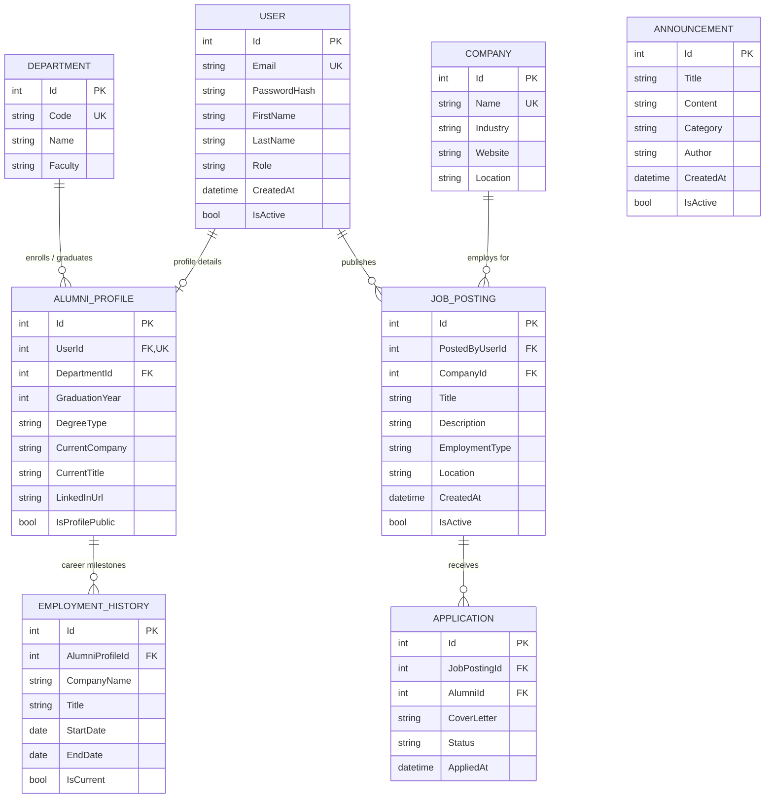

# 📊 Data Design Document (DDD)
## Konekto - University Communication and Alumni Tracking Platform

* **Document Version:** 1.0.0
* **Status:** Approved / Active Design
* **Target System:** ASP.NET Core 9.0 Web API & EF Core (Code-First)
* **Target Database:** Relational Database (MS SQL Server / PostgreSQL)
* **Specification Companion:** [README.md](./README.md)

---

## 1. Executive Summary & Objectives

### 1.1 Purpose
The purpose of this Data Design Document (DDD) is to define the logical and physical data models for **Konekto**, a next-generation alumni tracking and university networking system. It bridges the transition from initial in-memory prototyping (as tested in early API prototypes and container lifecycle verification) to a fully normalized, ACID-compliant, persistent relational database architecture.

### 1.2 Core Design Principles
1. **Third Normal Form (3NF) Compliance:** Minimizing redundancy and preserving referential integrity across students, graduates, academic departments, and employer networks.
2. **Clean Architecture Separation:** Isolating entity declarations in `Konekto.Domain` and persistence mapping rules in `Konekto.DataAccess` via EF Core.
3. **Containerized Persistence:** Ensuring complete data durability across Docker container recreations (`docker compose down` and `docker compose up`), solving "The Forgetting Problem" via managed Docker Volumes.
4. **KVKK / GDPR Compliance:** Strict separation between sensitive authentication credentials and public alumni career profiles, allowing granular user privacy toggles.

---

## 2. Conceptual Architecture & ER Diagram

The system centers around the core `User` identity, which conditionally associates with an `AlumniProfile`, career track history (`EmploymentHistory`), academic affiliation (`Department`), and professional listings (`JobPostings`).

### 2.1 Entity Relationship Diagram (ERD)



---

## 3. Data Dictionary & Detailed Table Schemas

### 3.1 `Users` Table
Stores authentication credentials, access roles, and base contact attributes.

| Column | Data Type (C# / SQL) | Constraints | Description |
| :--- | :--- | :--- | :--- |
| `Id` | `int` / `INT` | `PK`, `IDENTITY(1,1)` | Unique system identifier |
| `Email` | `string` / `NVARCHAR(150)` | `NOT NULL`, `UNIQUE` | Login email address |
| `PasswordHash` | `string` / `NVARCHAR(500)` | `NOT NULL` | Cryptographic hash (Argon2 / PBKDF2) |
| `FirstName` | `string` / `NVARCHAR(75)` | `NOT NULL` | First name of the user |
| `LastName` | `string` / `NVARCHAR(75)` | `NOT NULL` | Last name / surname |
| `Role` | `string` / `NVARCHAR(20)` | `NOT NULL`, `DEFAULT 'Alumni'` | `Admin`, `Alumni`, `Student`, `Academician` |
| `CreatedAt` | `DateTime` / `DATETIME2` | `NOT NULL`, `DEFAULT GETUTCDATE()` | Account registration timestamp |
| `IsActive` | `bool` / `BIT` | `NOT NULL`, `DEFAULT 1` | Soft-deletion and account status flag |

---

### 3.2 `Departments` Table
University faculty and department listings, prepared for Student Information System (SIS) integration.

| Column | Data Type (C# / SQL) | Constraints | Description |
| :--- | :--- | :--- | :--- |
| `Id` | `int` / `INT` | `PK`, `IDENTITY(1,1)` | Primary key |
| `Code` | `string` / `NVARCHAR(10)` | `NOT NULL`, `UNIQUE` | E.g., `CENG`, `MIS`, `IE` |
| `Name` | `string` / `NVARCHAR(120)` | `NOT NULL` | Department title |
| `Faculty` | `string` / `NVARCHAR(150)` | `NOT NULL` | Faculty / School name |

---

### 3.3 `AlumniProfiles` Table
Detailed academic history and professional status for alumni members.

| Column | Data Type (C# / SQL) | Constraints | Description |
| :--- | :--- | :--- | :--- |
| `Id` | `int` / `INT` | `PK`, `IDENTITY(1,1)` | Primary key |
| `UserId` | `int` / `INT` | `NOT NULL`, `FK(Users.Id)`, `UNIQUE` | One-to-one relationship with `User` |
| `DepartmentId` | `int` / `INT` | `NOT NULL`, `FK(Departments.Id)` | Academic origin |
| `GraduationYear` | `int` / `INT` | `NOT NULL` | Graduation year (e.g. `2024`) |
| `DegreeType` | `string` / `NVARCHAR(30)` | `NOT NULL`, `DEFAULT 'Bachelor'` | `Bachelor`, `Master`, `Doctorate` |
| `CurrentCompany` | `string?` / `NVARCHAR(150)` | `NULL` | Current employer name |
| `CurrentTitle` | `string?` / `NVARCHAR(100)` | `NULL` | Current job position (e.g. `Backend Engineer`) |
| `LinkedInUrl` | `string?` / `NVARCHAR(255)` | `NULL` | External professional profile URL |
| `Bio` | `string?` / `NVARCHAR(1000)` | `NULL` | Career summary / mentorship note |
| `IsProfilePublic`| `bool` / `BIT` | `NOT NULL`, `DEFAULT 1` | Privacy visibility toggle |

---

### 3.4 `EmploymentHistories` Table
Historical timeline tracking previous and current employment positions.

| Column | Data Type (C# / SQL) | Constraints | Description |
| :--- | :--- | :--- | :--- |
| `Id` | `int` / `INT` | `PK`, `IDENTITY(1,1)` | Primary key |
| `AlumniProfileId`| `int` / `INT` | `NOT NULL`, `FK(AlumniProfiles.Id)` | Associated alumni profile |
| `CompanyName` | `string` / `NVARCHAR(150)` | `NOT NULL` | Enterprise / institution name |
| `Title` | `string` / `NVARCHAR(100)` | `NOT NULL` | Position held |
| `StartDate` | `DateOnly` / `DATE` | `NOT NULL` | Employment start date |
| `EndDate` | `DateOnly?` / `DATE` | `NULL` | End date (`NULL` if current) |
| `IsCurrent` | `bool` / `BIT` | `NOT NULL`, `DEFAULT 0` | Flag indicating current active role |

---

### 3.5 `Companies` & `JobPostings` Tables
Facilitates networking, recruitment, and alumni-led job postings for recent graduates and students.

| Table | Key Columns | Relationships / Notes |
| :--- | :--- | :--- |
| **`Companies`** | `Id (PK)`, `Name (Unique)`, `Industry`, `Website`, `Location` | Centralized corporate catalog |
| **`JobPostings`** | `Id (PK)`, `PostedByUserId (FK -> Users)`, `CompanyId (FK -> Companies)`, `Title`, `Description`, `EmploymentType`, `Location`, `CreatedAt`, `IsActive` | Employment opportunities board (`Full-time`, `Internship`, `Remote`) |

### 3.6 `Applications` Table
Tracks alumni job applications submitted through the platform.

| Column | Data Type (C# / SQL) | Constraints | Description |
| :--- | :--- | :--- | :--- |
| `Id` | `int` / `INT` | `PK`, `IDENTITY(1,1)` | Primary key |
| `JobPostingId` | `int` / `INT` | `NOT NULL`, `FK(JobPostings.Id)` | The job being applied for |
| `AlumniId` | `int` / `INT` | `NOT NULL`, `FK(Alumni.Id)` | The applicant (alumni) |
| `CoverLetter` | `string?` / `NVARCHAR(2000)` | `NULL` | Optional motivation letter |
| `Status` | `string` / `NVARCHAR(30)` | `NOT NULL`, `DEFAULT 'Pending'` | `Pending`, `Reviewed`, `Accepted`, `Rejected` |
| `AppliedAt` | `DateTime` / `DATETIME2` | `NOT NULL`, `DEFAULT GETUTCDATE()` | Submission timestamp |

---

### 3.6 `Announcements` Table
Campus news, events, and career notifications published by administrators and alumni offices.

| Column | Data Type (C# / SQL) | Constraints | Description |
| :--- | :--- | :--- | :--- |
| `Id` | `int` / `INT` | `PK`, `IDENTITY(1,1)` | Primary key |
| `Title` | `string` / `NVARCHAR(250)` | `NOT NULL` | Announcement headline |
| `Content` | `string` / `NVARCHAR(4000)` | `NOT NULL` | Full announcement text |
| `Category` | `string` / `NVARCHAR(50)` | `NOT NULL`, `DEFAULT 'Genel'` | `Genel`, `Etkinlik`, `Kariyer`, `Akademik` |
| `Author` | `string` / `NVARCHAR(100)` | `NOT NULL`, `DEFAULT 'Yönetim'` | Publishing entity or department |
| `CreatedAt` | `DateTime` / `DATETIME2` | `NOT NULL`, `DEFAULT GETUTCDATE()` | Creation timestamp |
| `IsActive` | `bool` / `BIT` | `NOT NULL`, `DEFAULT 1` | Active visibility flag |

---

## 4. Indexing & Query Optimization Strategy

To support high-throughput API reads and fast alumni search filtering, the following indexes are prescribed:

1. **`IX_AlumniProfiles_Department_GradYear`**: Composite non-clustered index on `(DepartmentId, GraduationYear)` for student cohort analytics and alumni filtering.
2. **`IX_AlumniProfiles_CurrentCompany`**: Non-clustered index on `CurrentCompany` to support employer directory aggregations.
3. **`IX_JobPostings_IsActive_CreatedAt`**: Composite index on `(IsActive, CreatedAt DESC)` for low-latency job feed listing.
4. **`IX_Users_Email`**: Unique index enforcing single-account constraint per email address.

---

## 5. Storage Persistence & Docker Lifecycle ("The Forgetting Test" Resilience)

### 5.1 The Forgetting Problem
In testing environments without mounted volumes, container destruction via `docker compose down` destroys all in-container writes. 

### 5.2 Persistence Architecture
To guarantee persistence across container lifecycles:
* Relational database files (`.mdf`/`.ldf` for SQL Server or `/var/lib/postgresql/data` for Postgres) are bound to an explicit Docker named volume (`db_data`).
* Application restarts (`docker compose down` followed by `docker compose up`) reconnect to the persisted volume without data loss.

```yaml
# Persistence Volume Pattern in docker-compose.yml
services:
  db:
    image: mcr.microsoft.com/mssql/server:2022-latest
    volumes:
      - konekto_db_data:/var/opt/mssql/data
volumes:
  konekto_db_data:
    driver: local
```

---

## 6. Migration and Seed Strategy

1. **Initial Migration:** Managed via Entity Framework Core tooling (`dotnet ef migrations add InitialCreate`).
2. **Data Seeding:** Default departments and initial mock alumni cohorts (for SIS baseline) seeded via `OnModelCreating()` in `KonektoDbContext`.
3. **Rollback Safety:** All migrations must implement idempotent `Down()` methods to guarantee clean schema rollbacks if required.


---

## 7. API Routes

### Direct Routes
- GET    /api/job-postings
- GET    /api/job-postings/{id}
- POST   /api/job-postings
- PUT    /api/job-postings/{id}
- DELETE /api/job-postings/{id}

### Nested Routes (Applications)
- GET    /api/job-postings/{jobPostingId}/applications
- GET    /api/job-postings/{jobPostingId}/applications/{id}
- POST   /api/job-postings/{jobPostingId}/applications
- PUT    /api/job-postings/{jobPostingId}/applications/{id}
- DELETE /api/job-postings/{jobPostingId}/applications/{id}
